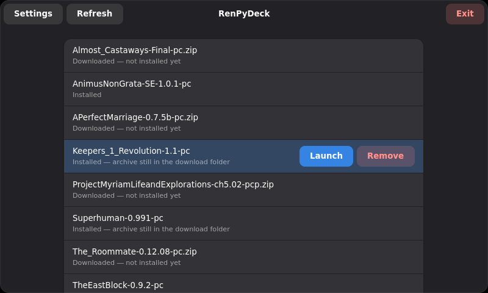

# RenPyDeck

A game manager and launcher for **Ren'Py** games — and for **HTML games**, such as those made
with Twine — designed first and foremost for the **Steam Deck**.

RenPyDeck keeps your collection of downloaded games in one place and turns the
download → install → play → uninstall lifecycle into a few taps in a clean graphical
interface. It handles the fiddly parts — unpacking archives into tidy subfolders and
fixing up the file permissions Linux needs — so you can get straight to playing.



*The library: downloaded archives and installed games in one list. The selected game shows
its buttons — here an installed game that still has its archive, so it can be launched,
and removed either way.*

---

## Features

- **Graphical game manager** with two clear lists: games you've **downloaded** (archives,
  ready to install) and games you've **installed** (extracted, ready to play).
- **Pick a game, then act on it** — the list shows names and states only. Tap a game to
  select it and its buttons appear on that row; tap it again to put them away. One game is
  selected at a time, so a long library stays readable and no button is ever ambiguous
  about which game it belongs to.
- **One-click install** — unpacks a downloaded archive into your games folder.
- **One-click launch** — runs an installed game.
- **HTML games too** — a game that is a web page zipped up with its pictures and music
  (typically a Twine/SugarCube story) plays right inside RenPyDeck's window. No browser is
  needed, and its saves are kept between sessions. See [Playing HTML games](#playing-html-games).
- **One-click removal** — deletes an installed game, its archive, or both, after a
  confirmation prompt that asks which. Removing the game you have finished with can leave
  the archive in place, ready to install again.
- **Keeps your archives by default** — installing leaves the downloaded archive where it
  is, so a game can be reinstalled without downloading it again. Switch *Delete the archive
  after installing* on in the settings to reclaim the space instead.
- **Many archive formats** — handles `.zip`, `.tar.bz2`, `.rar`, and other common
  compressed formats Ren'Py games are distributed in.
- **Configurable folder locations** for your downloads and your installed games.
- **Steam Deck friendly** — includes an on-screen **Exit** button, because the Deck's
  gaming mode hides window decorations (so there's no close button to rely on). The
  close/minimise/maximise buttons GTK would draw into the header are hidden as well: Exit
  already does the job, and they are awkward targets on a handheld.
- **Always dark** — the colour scheme reaches an app through the desktop portal, which
  gaming mode does not provide, so Flatpak apps start light there no matter how the desktop
  is set. RenPyDeck asks for dark itself.
- **One window, no dialogs** — questions, errors and even the folder browser are pages
  inside the main window. The Deck's gaming mode (the gamescope session) may never show a
  second window, and the system file picker it would need is unreachable there, so
  RenPyDeck opens neither.
- **Scrolls by finger** — lists can be dragged and flicked on the Deck's touchscreen, which
  gaming mode delivers as ordinary pointer input rather than as touch events (so GTK's own
  kinetic scrolling never sees it). Taps still activate buttons.
- **Linux-first** — support is decided by what's *inside* the archive, not by its
  filename: a Ren'Py game is playable only if it ships a Linux launch script, and an HTML
  game only if it comes without a Windows program. Windows-only games are detected and
  ignored, even when a "linux"-named archive isn't one (and vice versa). The same check decides what the library shows as installed: only a folder
  RenPyDeck can actually start is listed, so whatever else lives in your Games folder
  stays out of the way.
- **Automatic permission fixing** — sets the executable bit on the game's launch shell
  script and on the Linux runtime under its `lib` folder (the platform binary, `python`,
  `pythonw`, and the `.so` shared libraries), so games run even when the archive forgot to.
- **Room for game fixes** — RenPyDeck can recognise a game with a known defect when you
  launch it and add a small fix file beside the game's scripts, leaving the game's own
  files as they are. No fixes are included at the moment.
- **Tidy installs** — every game is always extracted into its own subfolder, even when the
  archive doesn't contain a top-level folder of its own, and even when the launch script
  is buried a level or two down.
- **Distributed as a Flatpak** — from its own repository, so Discover on the Steam Deck
  installs it and keeps it updated, or as a single-file bundle.

---

## How it works

RenPyDeck is built around two folders that you configure:

| Folder | Purpose | Default example |
| --- | --- | --- |
| **Download folder** | Holds your downloaded games as **compressed archives** (`.zip`, `.tar.bz2`, `.rar`, …). | `download/` |
| **Games folder** | Holds your **extracted, installed** games. | `games/` |

The application scans both folders to build its two lists. Every archive in the Download
folder is listed as it is — archives are never opened just to look inside, because reading
gigabytes of compressed data would make the library slow to open. Folders in the Games
folder, on the other hand, are cheap to look into, and only those holding a game RenPyDeck
can launch are listed.

In the library itself, a game is **selected before it is acted on**: rows carry just the
name and the state until you pick one, and only the selected row shows its buttons. Picking
another game moves them there; picking the same one again hides them. Nothing is selected
when the library opens. Afterwards the game you picked **stays picked**: when an install or
a launch has finished, its row is still the open one, now offering *Launch* where it offered
*Install*. Only a game that is no longer there — one you have just removed — leaves the
list with nothing selected.

### The game lifecycle

1. **Download** — Place a game's compressed archive into your **Download folder**. (RenPyDeck
   manages your library; downloading the archives themselves is up to you.) The game then
   appears in the **downloaded games** list.
2. **Install** — Select a downloaded game and choose **Install**. RenPyDeck unpacks the
   archive into your **Games folder**:
   - The game is always placed in its **own subfolder** (named after the archive), so loose
     files never spill into your Games folder. This holds whether the archive contains its
     files at the top level *or* already wraps them in its own folder.
   - After extraction, RenPyDeck **fixes executable permissions**: every `*.sh` launch
     script in the game — wherever it sits in the tree — and everything inside the game's
     `lib` folder, which is searched for rather than assumed to be at the top.
   - Once the game is unpacked, the **archive is kept** in the Download folder, so the game
     can be installed again later without downloading it a second time. Turn *Delete the
     archive after installing* on in the settings and it is deleted instead — a hard delete:
     the file does not go to the trash.
   - Support is decided by **content, not filename**, regardless of whether the archive is
     named `-win`, `-pc`, `-linux` or anything else. What was unpacked must be one of:
     - a **Ren'Py game**: a **`renpy` folder** (the engine — every Ren'Py game ships it)
       with a **`*.sh` launch script beside it** (the Linux launcher);
     - an **HTML game**: no `renpy` folder, an **`.html` page** to start from, and **no
       `.exe` file** anywhere. Games made with RPG Maker, TyranoScript and other
       NW.js-based tools also contain an `index.html`, but they are Windows programs built
       around it and need the browser bundled into their `.exe`, so they are refused.

     Anything else is refused: nothing is added to the Games folder, and the archive is
     kept.
3. **Play** — Choose **Launch** on an installed game. RenPyDeck runs the game's `*.sh`
   script from the game root — the folder holding `renpy` — with that folder as the working
   directory, which is what the script expects. The game takes over in its own window;
   RenPyDeck waits behind it with its buttons disabled, so only one game runs at a time. An
   HTML game plays inside RenPyDeck's own window instead, until you press **Quit game**.
4. **Remove** — Choose **Remove** to delete a game from the library, and RenPyDeck asks
   before deleting anything. For a game that is installed *and* still has its archive, the
   question offers all three answers — **Remove game**, **Remove archive**, **Remove
   both** — so you can free the space taken by the one you no longer need and keep the
   other. When there is only one thing to delete, it just names it and asks. This is a hard
   delete — nothing goes to the trash and nothing can be undone.

---

## For end users

### Installing RenPyDeck

RenPyDeck is distributed as a **Flatpak**, from its own repository at
<https://samo1.github.io/RenPyDeck/>. On any Linux machine it installs from a terminal:

```bash
flatpak install --user https://samo1.github.io/RenPyDeck/sk.meluzina.RenPyDeck.flatpakref
```

This adds the repository as a source as well, so updates come with `flatpak update` or
through your software center like any other app's. Every version is also attached to its
[GitHub release](https://github.com/samo1/RenPyDeck/releases) as a single-file bundle,
`RenPyDeck-<version>.flatpak`, for installing without the repository. An install from the
bundle still receives updates from the repository.

### Installing it on the Steam Deck

No terminal needed — do this in **Desktop Mode**:

1. Open <https://samo1.github.io/RenPyDeck/> in a browser and click
   **sk.meluzina.RenPyDeck.flatpakref**. Open the downloaded file, or double-click it in the
   file manager (Dolphin), and **Discover** opens showing RenPyDeck.
2. Click **Install**. Discover adds RenPyDeck's repository as a source and pulls in the
   GNOME runtime the first time, which takes a few minutes. After that, RenPyDeck appears in
   the application menu, and Discover offers its updates along with everything else's.

To install from the single-file bundle instead, download `RenPyDeck-<version>.flatpak` from
the releases page, double-click it, and choose **Install from local bundle**.

To play from **Gaming Mode**, add it to your Steam library while still in Desktop Mode:

3. In Steam, choose **Games → Add a Non-Steam Game to My Library…**. RenPyDeck is already in
   the list of applications — the Flatpak installs a desktop entry, so there is nothing to
   browse for. Tick it and confirm with **Add Selected Programs**.
4. Switch to Gaming Mode. RenPyDeck is under **Non-Steam** in your library.

#### Artwork for the Steam library

A non-Steam shortcut starts out as a blank tile with a name on it. RenPyDeck comes with
artwork you can use instead: download **`RenPyDeck-steam-assets.zip`** from the same release
as the bundle and unpack it. It holds one image per place Steam shows a game.

| File | Size | Steam calls it | Where it shows up |
| --- | --- | --- | --- |
| `grid-600x900.png` | 600×900 | Grid / vertical capsule | The tile in your library grid — the one Gaming Mode shows |
| `capsule-920x430.png` | 920×430 | Capsule (wide) | Big Picture and the *most recently played* banner |
| `hero-1920x620.png` | 1920×620 | Hero | The banner across the top of the game's page |
| `logo-1280x720.png` | 1280×720 | Logo | Transparent wordmark, drawn on top of the Hero |
| `icon-256x256.png` | 256×256 | Icon | List views and the shortcut itself |

To apply them, right-click RenPyDeck in your Steam library, choose **Manage → Set custom
artwork**, and pick the matching file for each. Steam saves them under
`~/.steam/steam/userdata/<your-id>/config/grid/` as `<appid>p.png` (grid), `<appid>.png`
(wide capsule), `<appid>_hero.png` and `<appid>_logo.png` — you can drop files there by
hand instead, but Steam has to be restarted to notice them, so the menu is easier.

Sizes are recommendations, not requirements: Steam scales anything with a sensible aspect
ratio, so artwork of your own works just as well. If you would rather have community art,
[SteamGridDB](https://www.steamgriddb.com/) is where most people get it.

#### Controller setup for Gaming Mode

Gaming Mode gives a non-Steam app whatever controller layout it is configured with, and the
default one has no mouse wheel — so the game list will not scroll. Before playing, select a
layout that does:

1. Launch RenPyDeck from your library, press the **STEAM** button and open
   **Controller Settings**.
2. Pick the **Web Browser** template (or any community layout meant for desktop apps). Its
   left trackpad is already a scroll wheel, which is what the list needs.
3. If you would rather adjust the layout by hand, choose **Edit Layout → Trackpads → Left
   Trackpad → Scroll Wheel**, and use the cog beside *Scroll* to set the swipe direction to
   **Vertical** if you prefer swiping over circular motion.

The **touchscreen** works without any of this: drag the list to scroll it, flick it to send
it gliding, and tap the buttons as usual.

### First run

1. Open **Settings** and set your **Download folder** and **Games folder** locations.
2. Put your game archives into the Download folder.
3. Use the interface to **install**, **launch**, and **remove** games.

### Using it on the Steam Deck

Because the Steam Deck doesn't show window decorations by default, RenPyDeck includes an
on-screen **Exit** button. Use it to close the application — the usual
close/minimise/maximise buttons are hidden, so Exit is how you leave.

### Playing HTML games

An HTML game is a web page with its pictures, music and fonts in folders beside it. Most
come from **Twine**, and are often a single file named after the story (`Taru_s Infernal
Pledge.html`) rather than `index.html`. RenPyDeck installs one like any other game. When you
press **Launch**, it opens the game in a page of its own window, using the web engine that is
already part of the Flatpak's runtime. You don't need a browser.

- **Quit game** in the header bar closes the game and returns to the library. It is the only
  way out: the back gesture, a swipe from the screen's edge and **Esc** are left to the
  game, so a stray swipe on the touchscreen can't throw away your progress. Save first
  — quitting doesn't ask.
- **Saves are kept.** A game's saves (its browser storage) stay in RenPyDeck's own data
  folder, `~/.var/app/sk.meluzina.RenPyDeck/data/renpydeck/web`. They survive quitting,
  closing RenPyDeck, removing the game, and installing a newer version of it. A newer
  version goes into a folder with a new name and still finds the old saves.
- **The game stays offline.** Links that would leave the game, such as one to the author's
  Patreon, are blocked, because in Gaming Mode there would be no browser to come back from.
  Exporting a save to a file isn't supported yet.
- **Controls:** these games are played with taps or a mouse. The touchscreen works as it is,
  and so does the trackpad-as-mouse in the **Web Browser** controller template (see
  [Controller setup for Gaming Mode](#controller-setup-for-gaming-mode)). The browser's
  gamepad support is not available to the game.

What isn't supported is a game that ships an `.exe`, even when it has an `index.html` inside.
RPG Maker MV/MZ, TyranoScript and other NW.js or Electron games fall in this group. They are
Windows programs that bundle their own browser and rely on parts of it a plain web page
doesn't have, so RenPyDeck refuses to install them.

---

## Configuration

RenPyDeck stores its settings in a plain **INI** file, following the XDG Base Directory
specification:

```
$XDG_CONFIG_HOME/renpydeck/config.ini      # usually ~/.config/renpydeck/config.ini
```

When run as a Flatpak the same path is redirected into the app's private config directory,
e.g. `~/.var/app/sk.meluzina.RenPyDeck/config/renpydeck/config.ini`.

The file is created automatically on first launch with sensible defaults, and is rewritten
whenever you change a folder in the configuration screen. It looks like this:

```ini
[folders]
download = /home/deck/Downloads
game = /home/deck/.local/share/renpydeck/games

[install]
delete_archive = false
```

| Key | Meaning | Default |
| --- | --- | --- |
| `folders.download` | Folder scanned for downloaded game archives. | Your desktop's standard **Downloads** folder (`XDG_DOWNLOAD_DIR`). |
| `folders.game` | Folder where games are extracted/installed. | `$XDG_DATA_HOME/renpydeck/games` (e.g. `~/.local/share/renpydeck/games`). |
| `install.delete_archive` | Delete the archive once the game is installed. | `false` — the archive is kept, so the game can be installed again without downloading it. |

Both folders are created on startup if they don't already exist. HTML games keep their saves
in a folder of their own, `$XDG_DATA_HOME/renpydeck/web`
(see [Playing HTML games](#playing-html-games)); there is nothing to configure about it. You can edit the file by
hand, but it's easier to use the in-app configuration screen. A missing or unreadable
`delete_archive` value counts as `false`, the setting that deletes nothing.

### Choosing folders outside the sandbox (Flatpak)

The Flatpak ships with read-write access to your **Downloads** folder
(`--filesystem=xdg-download`) — write access is needed to remove an archive, whether an
install consumes it or you delete it from the library — and the default game folder lives
in the app's own always-writable data directory. With those defaults, no extra setup is needed.

It also has access to **`~/.renpy`** (`--filesystem=~/.renpy:create`), the folder every
Ren'Py game keeps its saves in. That folder belongs to the games, not to RenPyDeck, and
sharing it is what makes a game play the same whether you start it here or straight from
the file manager: the same saves are there, and the game does not warn that a save was
"created on another computer". Without it the sandbox would hand each game an empty, throwaway
home — saves would disappear when RenPyDeck closes.

HTML games need no permission of their own: the web engine they play in comes with the
GNOME runtime, and their saves go to the app's own data directory.

The last permission is **sound** (`--socket=pulseaudio`, which is also what PipeWire serves
on SteamOS). RenPyDeck is silent itself; a game started without it would play mute.

If you want to point RenPyDeck at a location **outside** the sandbox — for example games on
a Steam Deck **SD card** (`/run/media/...`) or any other custom folder — the app needs
permission to reach it. RenPyDeck's folder browser is a plain view of the filesystem as the
sandbox presents it: it cannot grant access to anything the sandbox hides, so a folder you
have not allowed shows up empty or unreadable. Grant it a persistent permission instead —
either use **[Flatseal](https://flathub.org/apps/com.github.tchx84.Flatseal)** to add the
folder, or run `flatpak override`, for example:

```bash
# Access to a different download location (e.g. the SD card):
flatpak override --user --filesystem=/run/media/deck sk.meluzina.RenPyDeck

# Access to a custom game/install location:
flatpak override --user --filesystem=/run/media/deck/Games sk.meluzina.RenPyDeck
```

Replace the paths to match where your folders actually are. To grant access to your whole
home directory instead, use `--filesystem=home`. Both locations need read-write access: the
**game** location so games can be installed and uninstalled there, and the **download**
location so an installed game's archive can be deleted.

---

## For developers

The internals live in **[Development.md](Development.md)**: the tech stack, the project
layout, running RenPyDeck from source, building the Flatpak bundle, the anatomy of a Ren'Py
game, and the behaviours the implementation depends on.

---

## License

RenPyDeck is free software: you can redistribute it and/or modify it under the terms of the
**GNU General Public License** as published by the Free Software Foundation, either version
3 of the License, or (at your option) any later version.

It is distributed in the hope that it will be useful, but **without any warranty** — without
even the implied warranty of merchantability or fitness for a particular purpose. See the
[LICENSE](LICENSE) file for the full text, which also travels inside the Flatpak at
`/app/share/licenses/sk.meluzina.RenPyDeck/LICENSE`.

The licence covers RenPyDeck itself. The games it installs are not part of it and keep
whatever terms their own authors set.
